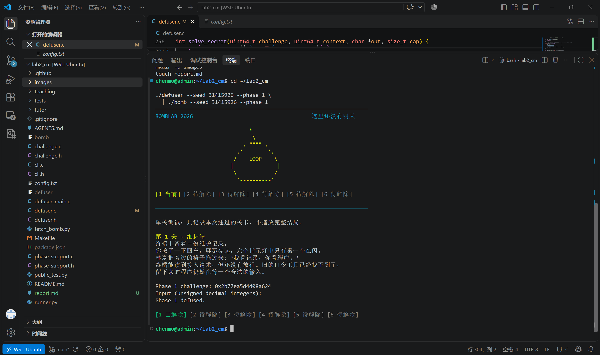
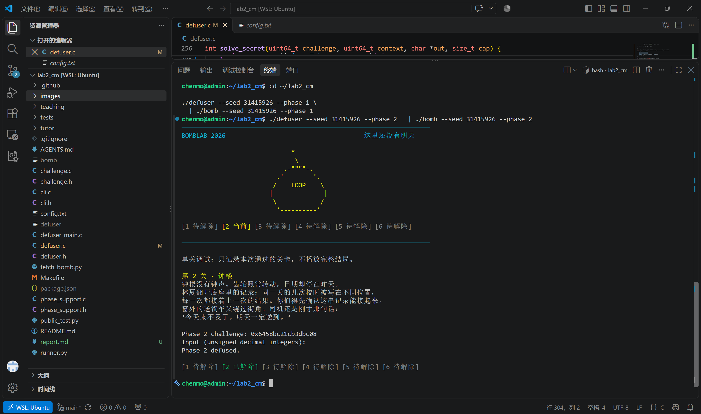
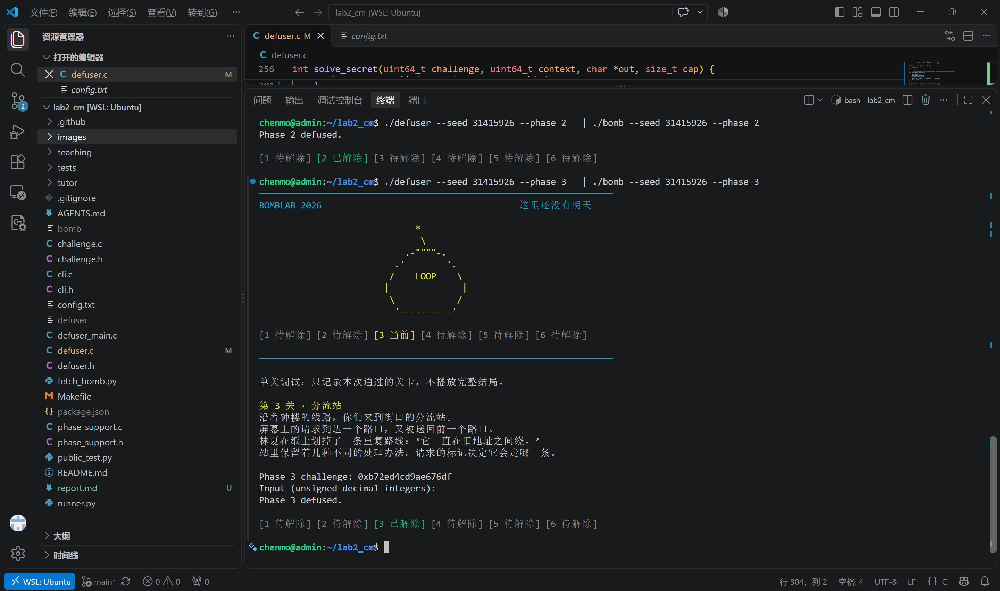
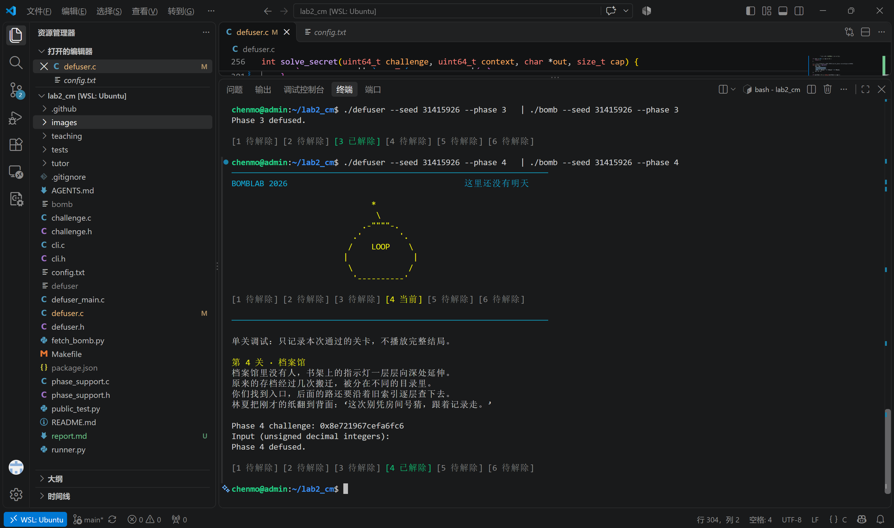
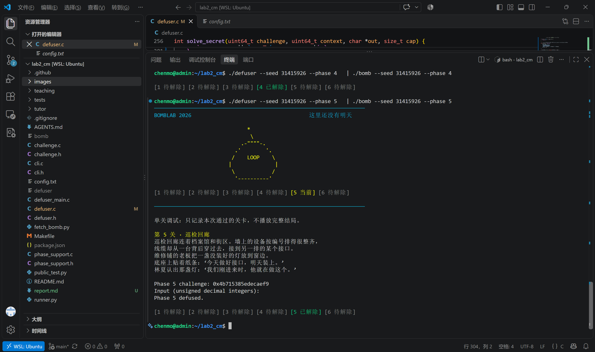
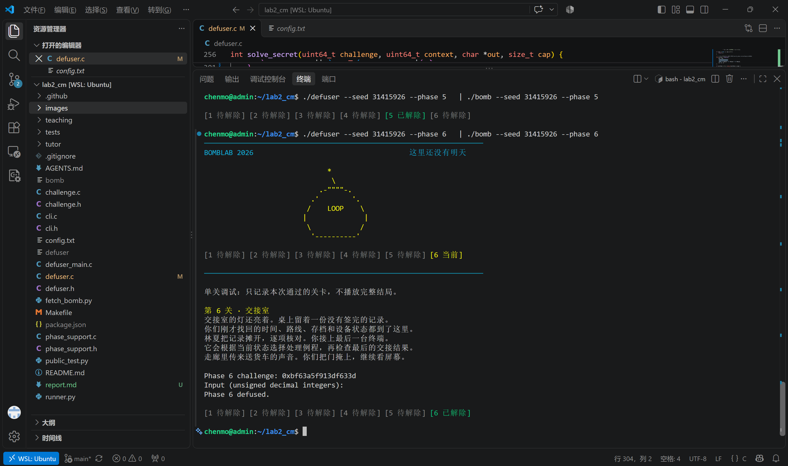
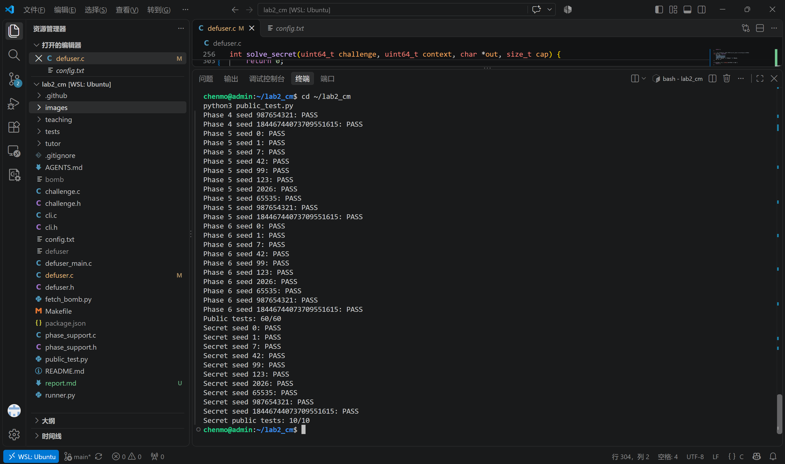
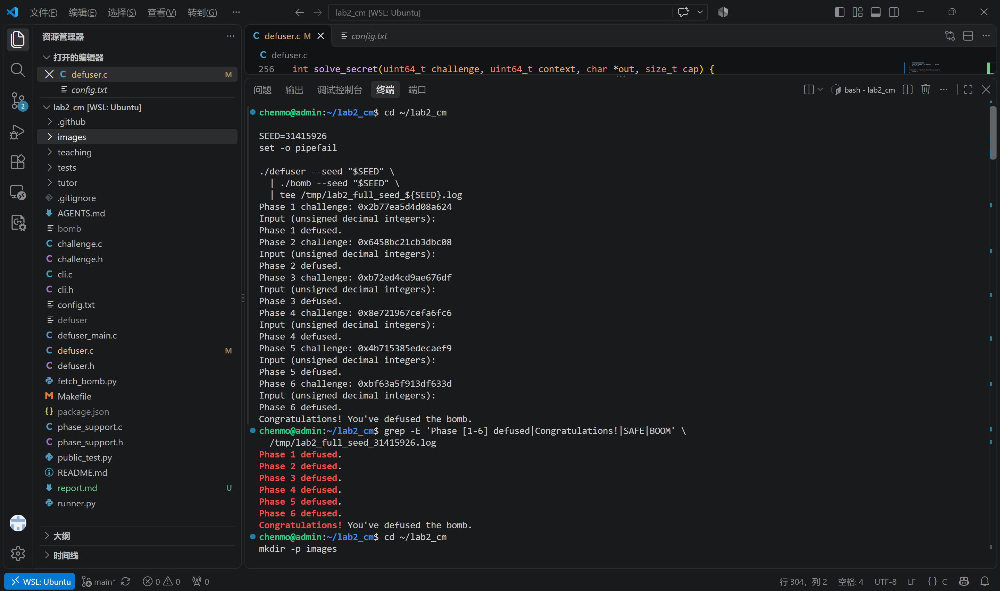

# BombLab 2026 实验报告

## 1. 实验目的

本实验要求通过分析 BombLab 程序的反汇编结果，恢复六个常规阶段及 Secret（Honor）阶段的输入计算关系，并在 `defuser.c` 中实现自动求解器。

实验的核心任务不是针对某个固定挑战值计算答案，而是理解程序如何从挑战值中提取数据、执行算术与逻辑运算、选择控制流路径，并最终生成满足检查条件的输入。求解器需要适应不同 seed 对应的挑战值，而不能依赖预先记录的答案。

本实验的主要目标包括：

1.  理解 x86-64 汇编中的数据传递、算术运算、位运算、条件分支和函数调用。
2.  根据挑战值恢复各阶段所需的整数序列或文本口令。
3.  将反汇编中的计算关系转换为 C 语言实现，并正确处理整数位宽、无符号溢出、递归调用和链式数据结构。
4.  使用公开测试、额外 seed 和完整程序运行验证求解器，并分析实现的正确性与局限性。

## 2. 实验环境与实现方案

### 2.1 实验环境

- 操作系统：Ubuntu（通过 WSL 运行）。
- 实现语言：C。
- 编译器：GCC。
- 反汇编工具：GNU `objdump`。
- 测试程序：课程提供的 `bomb`、`defuser` 和 `public_test.py`。
- 主要修改文件：`defuser.c`。

使用 Makefile 重新编译求解器，编译选项包括：

``` bash
make -B defuser
```

本次构建使用 `-std=c11 -O2 -Wall -Wextra -Wpedantic -Werror` 等选项，以严格检查 C 语言语法、类型使用和编译警告。

### 2.2 总体分析方法

整个分析过程围绕数据流和控制流展开。

首先，根据挑战值的位移、掩码和截断操作确定输入数据的来源；其次，沿寄存器读写关系恢复中间变量之间的计算顺序；对于条件分支、循环和递归，则进一步确定执行路径、循环边界和返回值的生成方式。最后，将恢复出的计算关系实现为 C 函数，并通过不同挑战值进行验证。

实现时尽量将参数提取、核心计算和输出组织分开。Phase 4 使用递归辅助函数，Phase 5 使用节点数组表达链式结构，Phase 6 将索引对应的变换集中在辅助函数中，Secret 阶段则分别处理参数混合、整数生成和文本格式化。

这种结构有助于将计算错误与输出格式错误区分开，也便于后续对照反汇编检查各个中间步骤。

### 2.3 整数位宽与运算语义

为避免 Markdown 数学渲染器对特殊符号的解析歧义，以下公式用 $\mathrm{AND}$ 表示按位与、用 $\mathrm{OR}$ 表示按位或；二者分别对应 C 语言中的 `&` 和 `|`，不是逻辑与或逻辑或。

本实验中，多数阶段使用 64 位挑战值作为输入，但中间计算通常对应 32 位寄存器。因此，代码使用 `uint64_t` 保存原始挑战值，并在需要时转换为 `uint32_t`。

对于 32 位无符号运算，结果按照模 $2^{32}$ 的规则回绕。计算结果超出 32 位范围时，保留低 32 位，而不是按无限精度整数继续增长。

例如：

$$
H=\mathrm{low}_{32}(C\gg32)
$$

表示将挑战值右移 32 位，再保留结果的低 32 位。

需要特别注意，右移 16 位后再转换为 `uint32_t`，并不等同于只提取原数中的 16 位；同样，异或运算不能与加法随意交换顺序。后续各阶段均按照实际计算关系处理位移、截断、算术运算和异或操作。

## 3. 前六个阶段的分析与实现

### 3.1 Phase 1：维护站——组合算术与异或

本阶段最终输出一个无符号整数。分析重点是确定 64 位挑战值中哪些部分参与计算，以及加法、乘法和异或的先后顺序。

**关键汇编摘录：**

``` asm
0000000000402020 <p1_step0>:
  402024: lea    eax,[rdi+rdi*2]
  402027: add    eax,esi
  402029: xor    eax,0x13b3
  40202e: ret

0000000000402030 <p1_step1>:
  402034: lea    eax,[rsi+0x693d]
  40203a: xor    eax,edi
  40203c: ret

0000000000402040 <p1_step2>:
  402044: lea    eax,[rdi+rsi*8]
  402047: xor    eax,0xe76c
  40204c: ret
```

`lea eax,[rdi+rdi*2]` 计算 `3*rdi`，随后 `add` 与 `xor` 依次完成第一步变换；`p1_step2` 将第一个参数与第二个参数的 8 倍相加，再异或常量 `0xE76C`；`p1_step1` 则将第二个参数加上 `0x693D` 后与第一个参数异或。结合调用处的参数传递顺序，可将这些指令对应到下文的 `T_0`、`T_2` 和最终输出公式。

令挑战值为 $C$，首先构造三个 32 位中间量：

$$
\begin{aligned}
L&=\mathrm{low}_{32}(C),\\
H&=\mathrm{low}_{32}(C\gg32),\\
M&=\mathrm{low}_{32}(C\gg16).
\end{aligned}
$$

随后依次计算：

$$
T_2=(H+8L)\oplus\mathtt{0xE76C}.
$$

$$
T_0=(3L+M)\oplus\mathtt{0x13B3}.
$$

$$
A_0=(T_2+\mathtt{0x693D})\oplus T_0.
$$

其中， $\oplus$ 表示按位异或。所有中间结果均按照 32 位无符号运算处理，最终只输出 $A_0$。

本阶段的关键是区分数据来源与运算顺序。位移和截断决定中间变量的取值范围，加法与乘法构造组合结果，异或则进一步改变结果的位模式。其中， $M$ 与 $L$ 并不是互不重叠的位段，因此不能将 $M$ 简化为单独的 16 位字段。

实现时将各个中间变量分别命名，使代码中的计算步骤能够与推导公式逐项对应，避免将所有运算压缩为难以检查的单一表达式。



### 3.2 Phase 2：钟楼——位段提取与循环递推

本阶段需要输出六个无符号整数。与 Phase 1 的组合计算不同，本阶段具有明确的递推结构：首项由挑战值的特定位段决定，后续项同时依赖挑战值中的位段、前一项和当前循环索引。

**关键汇编摘录：**

``` asm
00000000004020f0 <phase_02>:
  40215a: mov    rax,r13
  40215d: mov    esi,DWORD PTR [rbp-0x40]
  402160: shr    rax,0x14
  402164: and    eax,0x7f
  402167: xor    eax,0xf
  40216a: cmp    esi,eax
  40216c: jne    402115 <phase_02+0x25>
  40216e: mov    edx,0x1
  402173: lea    ecx,[rdx+0xb]
  402176: mov    rax,r13
  402179: shr    rax,cl
  40217c: lea    ecx,[rdx+rdx*2]
  40217f: and    eax,0xf
  402182: add    eax,esi
  402184: mov    esi,DWORD PTR [rbp+rdx*4-0x40]
  402188: xor    eax,ecx
  40218a: cmp    esi,eax
  40218c: jne    402115 <phase_02+0x25>
  40218e: add    rdx,0x1
  402192: cmp    rdx,0x6
  402196: jne    402173 <phase_02+0x83>
```

首项的 `shr`、`and 0x7f` 与 `xor 0xf` 对应七位字段提取和首项变换。循环中，`rdx` 是从 1 递增的索引：`lea ecx,[rdx+0xb]` 构造移位量 `i+11`，`and eax,0xf` 提取四位字段，`add eax,esi` 加上前一项，`lea ecx,[rdx+rdx*2]` 计算 `3*i`，再由 `xor eax,ecx` 得到当前期望值。最后通过 `cmp` 检查输入数组中的当前元素，并以 `rdx < 6` 控制循环次数。

设六个输出为 $A_0,A_1,\ldots,A_5$。首先计算首项：

$$
A_0=((C\gg20)\,\mathrm{AND}\,\mathtt{0x7F})
\oplus\mathtt{0x0F}.
$$

对于 $i=1,\ldots,5$，先提取四位数据：

$$
Q_i=(C\gg(i+11))\,\mathrm{AND}\,\mathtt{0x0F},
$$

再计算：

$$
A_i=(Q_i+A_{i-1})\oplus(3i).
$$

由此可见，后续元素不能独立计算。每次迭代都必须使用上一轮已经得到的结果；如果忽略这一依赖关系，便无法复现原程序的递推行为。

实现中将首项初始化与后续循环分开处理。首项使用七位掩码，后续每轮则提取四位数据，因此二者的移位量与掩码不能混用。循环从 $i=1$ 开始，到 $i=5$ 结束，共生成五个递推项，加上首项后得到六个输出。

本阶段的主要检查点是循环边界、位段宽度以及前一项的更新顺序。实现结果需要同时满足这些条件，而不能只在单个挑战值上得到正确输出。



### 3.3 Phase 3：分流站——选择变量与多分支计算

本阶段输出两个整数。第一个整数用于选择计算分支，第二个整数由所选分支对应的表达式计算得到。

**关键汇编摘录：跳转桩与分支函数。** 跳转表位于 `0x405820`，其表项先指向下列跳转桩；跳转桩地址的排列顺序并不等于 `p3_case_*` 的函数编号。

``` asm
402248: jmp    4021a0 <p3_case_0>
402250: jmp    402220 <p3_case_7>
402258: jmp    4021e0 <p3_case_4>
402260: jmp    4021f0 <p3_case_5>
402268: jmp    402200 <p3_case_6>
402270: jmp    4021d0 <p3_case_3>
402278: jmp    4021b0 <p3_case_1>
402280: jmp    4021c0 <p3_case_2>
```

八个分支中的关键算术指令如下：

``` asm
<p3_case_0>:
  4021a4: mov    eax,edi
  4021a6: shr    edi,1
  4021a8: xor    eax,0x1a79
  4021ad: add    eax,edi

<p3_case_1>:
  4021b4: lea    eax,[rdi+rdi*4+0x22844]

<p3_case_2>:
  4021c4: lea    eax,[rdi+rdi*1]
  4021c7: xor    eax,0x2bf1

<p3_case_3>:
  4021d4: lea    eax,[rdi+rdi*4+0x6787]

<p3_case_4>:
  4021e4: lea    eax,[rdi+rdi*2+0xd2ca]

<p3_case_5>:
  4021f4: lea    eax,[rdi+rdi*4+0xbd56]

<p3_case_6>:
  402204: lea    eax,[rdi*4+0x0]
  40220b: xor    eax,0x6127

<p3_case_7>:
  402224: mov    eax,edi
  402226: shr    edi,1
  402228: xor    eax,0x1947
  40222d: add    eax,edi
```

例如，`lea eax,[rdi+rdi*4+0x22844]` 对应 `5*x+0x22844`，而 `p3_case_0` 先异或常量再加上逻辑右移一位的结果。恢复时必须先按跳转表确定选择器映射，再按每个函数的指令恢复表达式；不能直接把选择器编号当作函数后缀。

首先提取选择变量：

$$
S=C\,\mathrm{AND}\,7.
$$

因此，$S$ 的取值范围为 0 至 7。随后构造混合变量：

$$
M=\mathrm{low}_{32}(C\gg32)
\oplus\mathrm{low}_{32}(C\gg3).
$$

第二个整数 $B$ 根据 $S$ 的取值计算：

| 选择值 $S$ | 第二个整数 $B$                     |
|-----------:|------------------------------------|
|          0 | $3M+\mathtt{0xD2CA}$               |
|          1 | $5M+\mathtt{0xBD56}$               |
|          2 | $(4M)\oplus\mathtt{0x6127}$        |
|          3 | $5M+\mathtt{0x6787}$               |
|          4 | $5M+\mathtt{0x22844}$              |
|          5 | $(2M)\oplus\mathtt{0x2BF1}$        |
|          6 | $(M\oplus\mathtt{0x1A79})+(M\gg1)$ |
|          7 | $(M\oplus\mathtt{0x1947})+(M\gg1)$ |

最终输出为：

$$
(S,B).
$$

八种情况中包含乘法、加法、异或和右移等不同操作，不能简单合并为统一的线性公式。例如，先异或再加上右移结果，与先完成加法再异或并不等价。

实现使用 `switch` 显式表达各个分支，选择变量始终作为第一个输出，分支计算结果作为第二个输出。这样可以清楚地区分分支选择和分支内部的计算，便于检查是否存在遗漏或常量混用。



### 3.4 Phase 4：档案馆——递归区间搜索与返回值变换

本阶段的核心是递归计算。挑战值决定目标值和密钥，程序在有限区间内反复计算中点，并根据目标值与中点的关系选择递归方向。与普通二分查找不同，递归函数还会在返回时进一步变换结果，因此最终输出取决于完整的递归路径。

**关键汇编摘录：入口参数构造。** `phase_04` 将目标值放入 `edi`，区间下界放入 `esi`，上界放入 `edx`，并将密钥放入 `ecx`，随后调用 `p4_walk`。

``` asm
0000000000402380 <phase_04>:
  4023c8: mov    rcx,r12
  4023cb: mov    rax,r12
  4023ce: mov    edi,r12d
  4023d1: xor    esi,esi
  4023d3: shr    rax,0x20
  4023d7: shr    rcx,0x7
  4023db: and    edi,0x7f
  4023de: mov    edx,0x7f
  4023e3: xor    ecx,eax
  4023e5: call   402310 <p4_walk>
  4023ea: cmp    DWORD PTR [rbp-0x14],eax
```

**关键汇编摘录：递归中点、分支与返回变换。**

``` asm
0000000000402310 <p4_walk>:
  402314: mov    eax,edi
  402316: mov    edi,edx
  402318: sub    edi,esi
  40231a: shr    edi,1
  40231c: add    edi,esi
  40231e: cmp    edi,eax
  402320: je     402370 <p4_walk+0x60>
  40232e: cmp    eax,edi
  402330: jb     402350 <p4_walk+0x40>
  402332: lea    esi,[rdi+0x1]
  402335: mov    edi,eax
  402337: call   402310 <p4_walk>
  40233c: lea    eax,[rax+rax*2]
  40233f: xor    eax,ebx
  402346: xor    eax,0x1a
  ; 右分支随后跳转至函数返回路径；中间控制流指令未在此摘录
  402350: lea    edx,[rdi-0x1]
  402353: mov    edi,eax
  402355: call   402310 <p4_walk>
  40235a: lea    eax,[rax+rax*2]
  40235d: xor    eax,ebx
  402364: xor    eax,0x16
  ; 左分支随后跳转至函数返回路径；中间控制流指令未在此摘录
  402370: lea    eax,[rdi+0x71]
  402373: xor    eax,ecx
  402375: ret
```

中点由 `high-low` 逻辑右移一位后加回 `low` 得到。目标值大于中点时更新下界为 `mid+1`，递归返回后执行乘 3、与当前层混合值异或，再异或 `0x1A`；目标值小于中点时更新上界为 `mid-1`，返回变换的末尾常量则是 `0x16`。命中中点时，基例直接计算 `(mid+0x71)^key`。因此，递归路径和每一层的返回变换都影响最终结果。

首先计算目标值与密钥：

$$
T=C\,\mathrm{AND}\,\mathtt{0x7F}.
$$

$$
K=\mathrm{low}_{32}(C\gg7)
\oplus\mathrm{low}_{32}(C\gg32).
$$

递归从区间 $[0,127]$ 开始。每次调用根据当前上下界计算中点：

$$
m=\mathrm{low}
+\left((\mathrm{high}-\mathrm{low})\gg1\right).
$$

当 $m=T$ 时，递归终止，返回：

$$
R=(m+\mathtt{0x71})\oplus K.
$$

若 $T>m$，则在右侧区间继续递归；若 $T<m$，则在左侧区间继续递归。递归调用返回后，当前层还需要构造：

$$
U=m+K.
$$

右侧递归返回后的结果为：

$$
R_{\mathrm{right}}
=((R_{\mathrm{child}}\times3)\oplus U)
\oplus\mathtt{0x1A}.
$$

左侧递归返回后的结果为：

$$
R_{\mathrm{left}}
=((R_{\mathrm{child}}\times3)\oplus U)
\oplus\mathtt{0x16}.
$$

因此，必须同时恢复向下搜索的区间更新规则和向上返回的数值变换。若只实现目标搜索而忽略递归返回过程，或者将左右分支的常量混用，都无法得到完整的输出。

实现中使用 `p4_walk_local` 表达递归过程。由于目标值通过七位掩码得到，始终处于初始区间内；每次递归都会缩小搜索范围，直到中点等于目标值。中点采用基于区间差值的写法，也使区间更新关系更加明确。



### 3.5 Phase 5：巡检回廊——链式节点遍历与累积计算

本阶段包含一个由多个节点构成的链式结构。每个节点保存后继关系以及两个参与计算的数据字段。挑战值决定起始节点、遍历参数和累积计算的初始值。

**关键汇编摘录：**

``` asm
0000000000402400 <p5_traverse>:
  402404: mov    rax,rdi
  402407: mov    rcx,rdi
  40240a: mov    r8,rsi
  40240d: and    eax,0x7
  402410: shr    rcx,0x3
  402414: mov    rdx,QWORD PTR [rax*8+0x405b60]
  40241c: mov    rax,rdi
  40241f: shr    rdi,0x20
  402423: shr    rax,0x6
  402427: xor    eax,edi
  402429: mov    esi,DWORD PTR [rdx+0x8]
  40242c: mov    edi,ecx
  40242e: xor    eax,0x3e6f
  402433: add    eax,DWORD PTR [rdx+0xc]
  402436: lea    eax,[rax+rax*4]
  402439: mov    DWORD PTR [r8],esi
  40243c: xor    eax,esi
  40243e: and    edi,0x3
  402441: je     402460 <p5_traverse+0x60>
  402448: mov    rdx,QWORD PTR [rdx]
  40244e: mov    esi,DWORD PTR [rdx+0x8]
  402451: add    eax,DWORD PTR [rdx+0xc]
  402454: lea    eax,[rax+rax*4]
  402457: mov    DWORD PTR [r8],esi
  40245a: xor    eax,esi
  40245c: cmp    edi,ecx
  40245e: jae    402448 <p5_traverse+0x48>
  402460: ret
```

`[rax*8+0x405b60]` 根据挑战值低三位查找起始节点指针；节点的 `+0x8` 和 `+0xC` 偏移分别读取 `a`、`b` 字段。`lea eax,[rax+rax*4]` 将累积值乘以 5，`xor eax,esi` 再与当前节点的 `a` 异或。循环中的 `mov rdx,QWORD PTR [rdx]` 沿节点首字段的后继指针前进，说明实际遍历顺序由链指针决定，而不是由节点在内存中的排列顺序决定。

分析时需要区分节点在内存中的物理排列顺序与实际遍历顺序。相邻地址不一定代表相邻访问节点，因此必须根据 `next` 字段追踪链路。

当前实现将每个节点表示为三个字段：

- `next`：后继节点的数组下标。
- `a`：参与异或运算的字段。
- `b`：参与加法运算的字段。

节点表如下。其中，`0xFFFFFFFF` 表示终止标记。

| 节点下标 | 原节点地址 |       `next` |     `a` |      `b` |
|---------:|------------|-------------:|--------:|---------:|
|        0 | `0x405BA0` |            5 | `0x231` | `0xDFCF` |
|        1 | `0x405BB0` |            8 | `0x326` | `0x8EEA` |
|        2 | `0x405BC0` |            4 | `0x448` | `0xD1BC` |
|        3 | `0x405BD0` |           10 | `0x66A` | `0x38BD` |
|        4 | `0x405BE0` |            0 | `0xA2B` | `0x269C` |
|        5 | `0x405BF0` |            7 | `0x877` | `0xC2E1` |
|        6 | `0x405C00` | `0xFFFFFFFF` | `0xB66` | `0x63CA` |
|        7 | `0x405C10` |            1 | `0x547` | `0x3C82` |
|        8 | `0x405C20` |            9 | `0x742` | `0xE26C` |
|        9 | `0x405C30` |            3 | `0x958` | `0xC2AB` |
|       10 | `0x405C40` |           11 |   `0xD` | `0x159B` |
|       11 | `0x405C50` |            6 | `0x163` | `0x938F` |

起始节点由挑战值低三位映射得到：

| $C\,\mathrm{AND}\,7$ | 起始节点下标 |
|-----------------:|-------------:|
|                0 |            2 |
|                1 |            4 |
|                2 |            0 |
|                3 |            5 |
|                4 |            7 |
|                5 |            1 |
|                6 |            8 |
|                7 |            9 |

遍历参数为：

$$
N=(C\gg3)\,\mathrm{AND}\,3.
$$

初始累积值为：

$$
R_0=
\left(
\mathrm{low}_{32}(C\gg6)
\oplus
\mathrm{low}_{32}(C\gg32)
\right)
\oplus\mathtt{0x3E6F}.
$$

每轮先处理当前节点，再根据后继字段决定是否继续移动。累积值依次更新为：

$$
R\leftarrow(R+b)\times5,
$$

$$
R\leftarrow R\oplus a.
$$

同时记录当前节点的 `a` 字段。由于循环条件为 `i <= N`，实际访问节点数为 $N+1$，而不是 $N$。遍历结束后，输出最终累积值和最后访问节点的 `a` 字段。

实现中使用静态数组保存节点信息，并通过 `next` 字段完成跳转。这样可以将原程序的链式访问关系转换为可检查的数组操作。需要特别注意的是，节点数组的存储顺序不能替代后继关系，访问次数也不能与后继跳转次数混为一谈。



### 3.6 Phase 6：交接室——索引驱动的两级变换

本阶段根据索引选择变换函数，并将第一次变换的结果继续作为第二次变换的输入。分析重点不仅是恢复各索引对应的运算，还要确定两次调用之间的数据依赖。

**关键汇编摘录：两次间接调用。** 函数指针表位于 `0x405E00`。第一次索引来自挑战值低三位；第二次索引由挑战值的 `0x38` 位段作为字节偏移量实现。

``` asm
0000000000402560 <p6_dispatch>:
  402568: push   rbx
  402569: mov    rbx,rdi
  40256c: shr    rdi,0x6
  402570: mov    rax,rbx
  402573: shr    rax,0x20
  402577: xor    edi,eax
  402579: mov    rax,rbx
  402580: and    ebx,0x38
  402583: and    eax,0x7
  402586: call   QWORD PTR [rax*8+0x405e00]
  40258d: xor    eax,0xf593
  402592: mov    edi,eax
  402594: call   QWORD PTR [rbx+0x405e00]
  40259f: add    eax,0xe8b7
  4025a4: ret
```

函数表及操作函数的关键指令对应关系如下：

|  表索引 | 实际函数  | 关键指令                                             | 运算含义                     |
|--------:|-----------|------------------------------------------------------|------------------------------|
|       0 | `p6_op_0` | `xor eax,0x5b5e`；`lea eax,[rax+rdi*2]`              | 先异或，再加上 `2X`          |
| 1、2、3 | `p6_op_5` | `rol eax,0x2`；`xor eax,0x40de`                      | 循环左移 2 位，再异或        |
|       4 | `p6_op_4` | `lea eax,[rdi+0x2763]`；`shr edi,0x7`；`xor eax,edi` | 加常量后与右移结果异或       |
|       5 | `p6_op_2` | `ror eax,0x3`                                        | 循环右移 3 位                |
|       6 | `p6_op_1` | `shl eax,0x5`；`add eax,0x49a0`；`xor eax,edx`       | 左移、加常量，再与 `3X` 异或 |
|       7 | `p6_op_3` | `shr eax,0x2`；`xor eax,edi`；`add eax,0x454a`       | 右移后异或，再加常量         |

这些操作函数均以 32 位寄存器完成计算。`rol` 和 `ror` 是循环移位，不等同于会丢弃移出位的普通 `shl` 或 `shr`。第二次间接调用使用第一次返回值异或 `0xF593` 后的结果，最后再加 `0xE8B7`，与下文的两级计算公式一致。

第一次调用的输入与索引为：

$$
X_1=
\mathrm{low}_{32}(C\gg6)
\oplus\mathrm{low}_{32}(C\gg32),
$$

$$
I_1=C\,\mathrm{AND}\,7.
$$

记索引驱动的变换函数为 $F(I,X)$，则第一次输出为：

$$
Y_1=F(I_1,X_1).
$$

随后构造第二次调用的输入与索引：

$$
X_2=Y_1\oplus\mathtt{0xF593},
$$

$$
I_2=(C\gg3)\,\mathrm{AND}\,7.
$$

第二次调用得到：

$$
Y_2=F(I_2,X_2).
$$

最终输出为：

$$
A_0=Y_2+\mathtt{0xE8B7}.
$$

变换函数 $F$ 根据索引选择不同运算：

|    索引 | 变换关系                                                |
|--------:|---------------------------------------------------------|
|       0 | $(X\oplus\mathtt{0x5B5E})+2X$                           |
| 1、2、3 | $((X\ll2)\,\mathrm{OR}\,(X\gg30))\oplus\mathtt{0x40DE}$ |
|       4 | $(X+\mathtt{0x2763})\oplus(X\gg7)$                      |
|       5 | $(X\gg3)\,\mathrm{OR}\,(X\ll29)$                        |
|       6 | $((X\ll5)+\mathtt{0x49A0})\oplus(3X)$                   |
|       7 | $((X\gg2)\oplus X)+\mathtt{0x454A}$                     |

其中，索引 1、2、3 对应的组合移位与按位或相当于 32 位循环左移两位；索引 5 对应的组合移位与按位或相当于循环右移三位。它们与普通移位的区别在于，被移出的位会重新进入另一端，而不是直接丢弃。

实现将不同索引对应的运算集中在 `p6_apply_local` 中，再按照实际依赖关系调用两次。第二次调用必须使用 $Y_1$ 与常量异或后的结果，不能重新使用原始输入 $X_1$。

本阶段的关键在于同时保证索引提取、变换表达式和调用顺序正确。任何一处错误都可能使最终结果偏离预期。



## 4. Secret（Honor）阶段

### 4.1 参数混合与整数生成

Secret 阶段同时接收 `challenge` 和 `context`，并要求输出包含固定前缀和关键字的文本。因此，除了恢复整数计算关系，还需要检查输出字符串的布局。

**关键汇编摘录：入口门控与字符串位置。** `secret_gate` 先检查输入长度，再复制输入并检查偏移 32 处是否为 `OPEN`；之后将偏移 36 处的内容交给 `secret_phase` 解析。

``` asm
0000000000402700 <secret_gate>:
  40273c: call   401190 <strlen@plt>
  402741: sub    rax,0x24
  402745: cmp    rax,0x7f
  402749: jbe    402760 <secret_gate+0x60>
  402766: call   4026e0 <secret_copy>
  40276b: cmp    DWORD PTR [rbp-0xb0],0x4e45504f
  402775: jne    40274b <secret_gate+0x4b>
  40277d: lea    rdi,[rbp-0xac]
  402784: call   402620 <secret_phase>

0000000000402610 <secret_mix>:
  402614: mov    eax,edi
  402616: ror    eax,1
  402618: xor    eax,0x6887
  40261d: ret
```

这里的比较常量 `0x4E45504F` 在小端内存中的字节顺序对应字符串 `OPEN`。复制缓冲区起点为 `[rbp-0xd0]`，检查位置 `[rbp-0xb0]` 相差 `0x20` 字节，因此关键字前必须恰好有 32 个字符；`lea rdi,[rbp-0xac]` 则把解析起点放在关键字之后。`secret_mix` 的 `ror eax,1` 是 32 位循环右移一位，随后异或 `0x6887`。

**关键汇编摘录：三个整数的依赖关系。**

``` asm
0000000000402620 <secret_phase>:
  402680: mov    ecx,r13d
  402685: and    ecx,0x3
  402688: cmp    DWORD PTR [rbp-0x2c],ecx
  402690: imul   r9d,ecx,0x951c
  40269a: shr    rsi,0x20
  40269e: shr    r8,0x20
  4026a2: xor    esi,r12d
  4026a5: xor    r8d,r13d
  4026a8: shr    r13,0x10
  4026ac: mov    edi,esi
  4026ae: xor    r9d,r13d
  4026b1: xor    edi,r8d
  4026b4: call   402610 <secret_mix>
  4026b9: xor    eax,r9d
  4026bc: cmp    DWORD PTR [rbp-0x28],eax
  4026c1: shr    esi,1
  4026c3: lea    edx,[r8+rcx+0xfd9b]
  4026cb: add    edx,esi
  4026cd: xor    eax,edx
  4026cf: cmp    eax,DWORD PTR [rbp-0x24]
```

这段指令先检查第一个整数是否等于 `context & 3`，再由 `challenge`、`context` 的高低 32 位构造混合值，调用 `secret_mix` 后生成第二个整数的期望值；最后将 `challenge` 的混合值逻辑右移一位，并与 `context` 的混合值、首个整数和常量 `0xFD9B` 相加，再与前一步结果异或，得到第三个整数的检查值。计算次序和 32 位截断语义都必须保留。

首先将两个 64 位参数压缩为 32 位中间量：

$$
C'=\mathrm{low}_{32}(challenge)
\oplus\mathrm{low}_{32}(challenge\gg32),
$$

$$
K'=\mathrm{low}_{32}(context)
\oplus\mathrm{low}_{32}(context\gg32).
$$

第一个整数由 `context` 的低两位决定，对应的 C 语言表达式为 `V_0 = context & 3`。

随后混合两个中间量：

$$
Z=C'\oplus K'.
$$

将 $Z$ 循环右移一位，再与常量异或：

$$
M=((Z\gg1)\,\mathrm{OR}\,(Z\ll31))
\oplus\mathtt{0x6887}.
$$

接着计算：

$$
Q=(V_0\times\mathtt{0x951C})
\oplus\mathrm{low}_{32}(context\gg16),
$$

$$
V_1=M\oplus Q,
$$

$$
V_2=V_1\oplus
\left(
K'+V_0+\mathtt{0xFD9B}+(C'\gg1)
\right).
$$

所有相关中间结果均按 32 位无符号运算处理。循环右移与普通右移不同，最低位会重新进入最高位，因此不能仅使用右移操作代替循环移位。

### 4.2 输出格式与缓冲区检查

当前实现构造的文本格式为：

``` text
AAAAAAAAAAAAAAAAAAAAAAAAAAAAAAAAOPEN V0 V1 V2
```

其中，固定前缀由 32 个字符 `A` 组成，随后紧接 `OPEN` 和三个整数。前缀长度是输出协议的一部分，即使整数计算正确，如果关键字出现在错误的位置，仍可能导致解析失败。

实现使用 `snprintf` 构造输出，并检查以下情况：

1.  `out` 为空指针或 `cap` 为 0 时，返回求解失败。
2.  `snprintf` 返回负值时，认为格式化过程失败。
3.  返回值大于或等于缓冲区容量时，认为输出不完整。
4.  只有确认完整字符串写入缓冲区后，才返回成功状态。

这些检查用于保证输出格式和缓冲区使用符合接口要求，但不能替代对整数计算关系的验证。

### 4.3 验证结果

公开测试记录显示，Secret 阶段的十个 seed 全部通过，结果为 `Secret public tests: 10/10`。

该结果表明当前实现通过了测试脚本覆盖的 Secret 测试。由于 Secret 阶段与前六关使用的输入接口和检查逻辑不同，因此将其测试结果单独记录。



## 5. 测试设计与结果分析

### 5.1 严格编译检查

修改完成后执行：

``` bash
make -B defuser
```

`-B` 要求 Makefile 重新执行构建，避免因目标文件时间戳而跳过编译。本次编译成功，未因 `-Werror` 触发编译失败。

编译成功只能说明程序通过编译器检查，不能单独证明算法正确，因此还需要进行公开测试和实际炸弹运行。

### 5.2 公开测试

执行：

``` bash
python3 public_test.py
```

测试结果如下：

| 测试范围           |       结果 |
|--------------------|-----------:|
| Phase 1–6 公开测试 | 60/60 PASS |
| Secret 公开测试    | 10/10 PASS |

前六关分别在十个 seed 下测试，共得到 60 个通过结果；Secret 阶段另有十个通过结果。

这些测试能够检查不同挑战值下的位段提取、递推、分支选择和输出组织等行为，但测试集仍然有限，不能等同于对所有可能输入的形式化证明。

### 5.3 非公开 seed 的完整运行

为检验求解器是否只适用于公开测试，额外使用 seed `31415926` 进行完整炸弹运行：

``` bash
SEED=31415926
set -o pipefail

./defuser --seed "$SEED" \
  | ./bomb --seed "$SEED"
```

`set -o pipefail` 用于避免管道前序命令失败时，其错误状态被最后一个命令的退出状态掩盖。

本次运行中，各阶段的挑战值如下：

| 阶段    | 挑战值               |
|---------|----------------------|
| Phase 1 | `0x2b77ea5d4d08a624` |
| Phase 2 | `0x6458bc21cb3dbc08` |
| Phase 3 | `0xb72ed4cd9ae676df` |
| Phase 4 | `0x8e721967cefa6fc6` |
| Phase 5 | `0x4b715385edecaef9` |
| Phase 6 | `0xbf63a5f913df633d` |

六个阶段均显示 `defused`，程序最终输出：

``` text
Congratulations! You've defused the bomb.
```



此外，还使用下列十个 seed 逐一执行完整流程，并通过检查最终的 `Congratulations!` 确认所有阶段完成：

`0`、`1`、`7`、`42`、`99`、`123`、`2026`、`65535`、`987654321`、`18446744073709551615`。

这组完整流程测试的结果为 `10/10 PASS`。它们与 `public_test.py` 的阶段级测试虽使用相同 seed 列表，但验证方式不同：前者将 `defuser` 的输出直接传给 `bomb`，检查整个六阶段流程；后者分别检查各阶段求解器的输出。另有 seed `31415926` 的完整运行记录，作为公开列表之外的额外验证。

### 5.4 测试结果的意义与局限

本次验证覆盖了三个层次：

1.  **编译层面：** 检查 C 语言代码是否能够在严格编译选项下通过构建。
2.  **阶段层面：** 通过公开测试检查六个阶段和 Secret 阶段在多个 seed 下的输出。
3.  **完整流程层面：** 通过非公开 seed 的完整运行，检查六个阶段按顺序执行时的整体行为。

多组挑战值能够增加对实现正确性的信心，也有助于发现硬编码答案、遗漏分支或错误的循环边界。但这些测试并未穷举全部 64 位输入，因此不能据此声称求解器已经获得形式化证明。

### 5.5 文件与实现检查

提交前检查了工作区状态、代码差异和格式：

``` bash
git diff --check
git status --short
git diff --stat
```

`git diff --check` 用于检查差异中的多余空白等格式问题。程序源代码修改集中在 `defuser.c`；`report.md` 是课程要求的实验报告提交物。测试程序、驱动程序和工作流文件均未作为解法的一部分修改。

这些检查有助于确认提交内容与实验目标一致，但不能代替对算法本身的复核。

## 6. 结果讨论

综合实现和测试结果，本次实验取得了以下进展。

首先，六个常规阶段均已实现。它们分别涉及组合算术、位段递推、多分支计算、递归区间搜索、链式节点遍历和索引驱动的两级变换。通过将不同控制结构转换为对应的 C 语言结构，求解过程能够根据挑战值动态生成输入，而不是依赖固定答案。

其次，Secret 阶段也已实现。除整数计算外，该阶段还要求同时处理两个参数、循环移位、多个中间变量之间的依赖关系，以及固定文本格式和缓冲区容量。这些要求说明，输出协议本身也是求解器正确性的一部分。

最后，测试结果显示，当前实现通过了前六关的 60 项公开测试和 Secret 阶段的 10 项公开测试，并通过了已记录的完整炸弹运行。不同层次的验证相互补充，但不能完全替代对反汇编和计算关系的逐项核对。

仍需注意，Phase 5 的节点字段与后继关系、Phase 4 的递归返回变换以及 Secret 阶段的文本解析位置，都应以当前个人二进制的实际行为为依据。测试通过可以作为重要证据，但公式、常量和结构数据的来源仍应能够从反汇编分析中解释清楚。

## 7. 实验总结

本次 BombLab 实验的主要工作，是将二进制程序中的输入检查逻辑转换为可执行、可重复验证的 C 语言计算过程。

在分析方法上，实验需要先确定数据来自挑战值的哪些位段，再恢复算术和逻辑运算的顺序；对于分支、循环和递归，则需要进一步理解控制流及其对应的状态更新。对于链式结构，必须沿后继字段追踪实际访问顺序；对于多级变换，则必须保证不同调用之间的数据依赖正确。

在实现和验证方面，严格编译、公开测试以及不同 seed 下的完整运行分别检查了代码质量、阶段计算和整体执行流程。实验结果说明，正确的求解器不仅需要计算关系正确，还必须保证整数位宽、输出数量、参数顺序和文本格式与原程序的要求一致。

本次实验也表明，测试通过与完整理解程序并不是同一件事。只有能够解释关键计算关系，并将其与实际反汇编和代码实现对应起来，才能更可靠地判断求解器是否正确。

## 8. 参考资料与辅助工具

### 8.1 参考资料

1.  课程提供的 BombLab 2026 项目说明及 `README.md`。
2.  课程提供的个人 `bomb` 程序及其反汇编输出。
3.  GNU `objdump` 工具文档。
4.  GCC 编译器文档及 C 语言整数类型、移位和无符号算术相关资料。

### 8.2 辅助工具使用说明

实验过程中使用 ChatGPT 辅助理解汇编指令与 C 语言语义、讨论实现结构、检查测试方案，并协助整理实验报告。代码的编译结果、公开测试结果和完整炸弹运行结果均以本地实际执行记录为依据。
